  

  <b>Desenvolvedora Back-End</b> · Estudante de Ciência da Computação

  
  

---

### Sobre mim

- Desenvolvo **back-end** na **SEMEC – Secretaria de Economia da Prefeitura de Porto Velho**
- Curso **Ciência da Computação**
- Gosto muito de **Inteligência Artificial**: LLMs, agentes e tudo o que une IA e software de verdade
- Curiosidade: gosto de automatizar tudo o que dá 

---

### 🛠️ Tecnologias

**Linguagens**

**Back-end e ferramentas**

**IA**

---

  <i>“Quanto mais estudo, mais sinto que minha mente nisso é insaciável.” - Ada Lovelace</i>

